# Roger Yeoh

**Independent Developer · Apple Platforms · AI & Machine Learning**

I build practical tools, thoughtful interfaces, and experiments that help me understand how technology works.

---

### Selected work

| Project | What it does |
| :-- | :-- |
| 📻 **[Radio DIAL](https://github.com/rogeryeoh49-bot/Radio-DIAL)** | A **free macOS internet-radio and podcast player** with receiver-inspired themes, recording, scheduled playback tools, and audio visualizers. No subscription required. |
| 🎵 **[LinerNotes](https://github.com/rogeryeoh49-bot/LinerNotes)** | A **SwiftUI music-discovery app** for exploring samples, production credits, and connections between recordings. The public repository showcases the UI and architecture; production data services are separate. |
| ♟️ **[Minimax Tic-Tac-Toe](https://github.com/rogeryeoh49-bot/Minimax-Tic-Tac-Toe)** | A playable game with an **unbeatable Minimax opponent** and GUI. My project report was published in the *2025 FitzEd Winter and Summer School Journal*. |

<b>More experiments and utilities</b>

 

- **[Bluetooth Sonar](https://github.com/rogeryeoh49-bot/bluetooth_sonar)** — A sonar-style interface for exploring Bluetooth signal strength and approximate proximity.
- **[FrameFloat](https://github.com/rogeryeoh49-bot/FrameFloat)** — A lightweight macOS overlay for measuring display-link refresh cadence and visualizing frame intervals.
- **[WhoSampledCrawler](https://github.com/rogeryeoh49-bot/WhoSampledCrawler)** — A Python experiment in collecting and organizing music-sampling metadata.

### Tools & technologies

  
  
  
  
  
  

### GitHub at a glance

<!-- PROFILE_STATS_START -->

  <picture>
    <source media="(prefers-color-scheme: dark)" srcset="./assets/profile/overview.dark.svg" />
    
  </picture>
  <picture>
    <source media="(prefers-color-scheme: dark)" srcset="./assets/profile/languages.dark.svg" />
    
  </picture>

Generated daily from GitHub data. Language breakdown reflects repository code, not proficiency. These cards are hosted in this repository.
<!-- PROFILE_STATS_END -->

### What I'm exploring

- **Apple-platform development** — Designing native experiences that feel simple, fast, and useful.
- **AI reliability** — Understanding why models make mistakes and how their outputs can be evaluated.
- **Algorithms & experimentation** — Learning through projects, from game-tree search to signal processing.

> **Build something useful. Understand why it works. Keep improving it.**

### Website status

🌐 **Personal website — temporarily unavailable**  
`rogeryeoh.dpdns.org` is currently returning HTTP 403. I'm investigating a possible Cloudflare-related access issue and considering a move to another domain.

---

Built with curiosity. See the repositories above for source code, demos, and project notes.

