# Roger Yeoh

**Independent Developer · AI & Machine Learning**

I build practical tools, thoughtful interfaces, and experiments that help me understand how technology works.

<a href="mailto:rogeryeoh49@gmail.com"><picture><source media="(prefers-color-scheme: dark)" srcset="https://img.shields.io/badge/Email-Contact%20me-262B35?style=flat-square&amp;logo=gmail&amp;logoColor=white" /></picture></a>
<a href="https://github.com/rogeryeoh49-bot/Radio-DIAL/releases/latest"><picture><source media="(prefers-color-scheme: dark)" srcset="https://img.shields.io/badge/macOS-Try%20Radio%20DIAL-262B35?style=flat-square&amp;logo=apple&amp;logoColor=white" /></picture></a>

### Personal website: [rogeryeoh49-bot.github.io](https://rogeryeoh49-bot.github.io/)

My custom domain (<code>rogeryeoh.dpdns.org</code>) is still returning HTTP 403, and I'm waiting to hear back from Cloudflare. In the meantime, you can find my site on GitHub Pages at the link above.

---

### You gotta see ... 👇

| Project | What it does |
| :-- | :-- |
| 📻 **[Radio DIAL](https://github.com/rogeryeoh49-bot/Radio-DIAL)** | A **free macOS internet-radio and podcast player** with receiver-inspired themes, recording, scheduled playback tools, and audio visualizers. No subscription required. |
| 🎵 **[LinerNotes](https://github.com/rogeryeoh49-bot/LinerNotes)** | A **SwiftUI music-discovery app** for exploring samples, production credits, and connections between recordings. The public repository showcases the UI and architecture; production data services are separate. |
| ♟️ **[Minimax Tic-Tac-Toe](https://github.com/rogeryeoh49-bot/Minimax-Tic-Tac-Toe)** | A playable game with an **unbeatable Minimax opponent** and GUI. My project report was published in the *2025 FitzEd Winter and Summer School Journal*. |

<b>More experiments and utilities</b>

 

- **[Bluetooth Sonar](https://github.com/rogeryeoh49-bot/bluetooth_sonar)** — A sonar-style interface for exploring Bluetooth signal strength and approximate proximity.
- **[FrameFloat](https://github.com/rogeryeoh49-bot/FrameFloat)** — A lightweight macOS overlay for measuring display-link refresh cadence and visualizing frame intervals.
- **[WhoSampledCrawler](https://github.com/rogeryeoh49-bot/WhoSampledCrawler)** — A Python experiment in collecting and organizing music-sampling metadata.

### Things I Code With

  <picture>
    <source media="(prefers-color-scheme: dark)" srcset="https://img.shields.io/badge/Swift-252B36?style=flat-square&amp;logo=swift&amp;logoColor=F05138" />
    
  </picture>
  <picture>
    <source media="(prefers-color-scheme: dark)" srcset="https://img.shields.io/badge/SwiftUI-252B36?style=flat-square&amp;logo=swift&amp;logoColor=F05138" />
    
  </picture>
  <picture>
    <source media="(prefers-color-scheme: dark)" srcset="https://img.shields.io/badge/Python-252B36?style=flat-square&amp;logo=python&amp;logoColor=3776AB" />
    
  </picture>
  <picture>
    <source media="(prefers-color-scheme: dark)" srcset="https://img.shields.io/badge/JavaScript-252B36?style=flat-square&amp;logo=javascript&amp;logoColor=F7DF1E" />
    
  </picture>
  <picture>
    <source media="(prefers-color-scheme: dark)" srcset="https://img.shields.io/badge/HTML5-252B36?style=flat-square&amp;logo=html5&amp;logoColor=E34F26" />
    
  </picture>
  <picture>
    <source media="(prefers-color-scheme: dark)" srcset="https://img.shields.io/badge/CSS3-252B36?style=flat-square&amp;logo=css&amp;logoColor=1572B6" />
    
  </picture>
  <picture>
    <source media="(prefers-color-scheme: dark)" srcset="https://img.shields.io/badge/C-252B36?style=flat-square&amp;logo=c&amp;logoColor=A8B9CC" />
    
  </picture>
  <picture>
    <source media="(prefers-color-scheme: dark)" srcset="https://img.shields.io/badge/Objective--C-252B36?style=flat-square&amp;logo=apple&amp;logoColor=B8C6DD" />
    
  </picture>
  <picture>
    <source media="(prefers-color-scheme: dark)" srcset="https://img.shields.io/badge/Ruby-252B36?style=flat-square&amp;logo=ruby&amp;logoColor=CC342D" />
    
  </picture>
  <picture>
    <source media="(prefers-color-scheme: dark)" srcset="https://img.shields.io/badge/Bash-252B36?style=flat-square&amp;logo=gnubash&amp;logoColor=4EAA25" />
    
  </picture>
  <picture>
    <source media="(prefers-color-scheme: dark)" srcset="https://img.shields.io/badge/Xcode-252B36?style=flat-square&amp;logo=xcode&amp;logoColor=147EFB" />
    
  </picture>
  <picture>
    <source media="(prefers-color-scheme: dark)" srcset="https://img.shields.io/badge/AppKit-252B36?style=flat-square&amp;logo=apple&amp;logoColor=A4BDF5" />
    
  </picture>
  <picture>
    <source media="(prefers-color-scheme: dark)" srcset="https://img.shields.io/badge/CloudKit-252B36?style=flat-square&amp;logo=icloud&amp;logoColor=3693F3" />
    
  </picture>
  <picture>
    <source media="(prefers-color-scheme: dark)" srcset="https://img.shields.io/badge/AVFoundation-252B36?style=flat-square&amp;logo=applemusic&amp;logoColor=FC3C44" />
    
  </picture>
  <picture>
    <source media="(prefers-color-scheme: dark)" srcset="https://img.shields.io/badge/Electron-252B36?style=flat-square&amp;logo=electron&amp;logoColor=9FEAF9" />
    
  </picture>
  <picture>
    <source media="(prefers-color-scheme: dark)" srcset="https://img.shields.io/badge/Node.js-252B36?style=flat-square&amp;logo=nodedotjs&amp;logoColor=5FA04E" />
    
  </picture>
  <picture>
    <source media="(prefers-color-scheme: dark)" srcset="https://img.shields.io/badge/Three.js-252B36?style=flat-square&amp;logo=threedotjs&amp;logoColor=FFFFFF" />
    
  </picture>
  <picture>
    <source media="(prefers-color-scheme: dark)" srcset="https://img.shields.io/badge/FFmpeg-252B36?style=flat-square&amp;logo=ffmpeg&amp;logoColor=007808" />
    
  </picture>
  <picture>
    <source media="(prefers-color-scheme: dark)" srcset="https://img.shields.io/badge/Playwright-252B36?style=flat-square&amp;logo=playwright&amp;logoColor=2EAD33" />
    
  </picture>
  <picture>
    <source media="(prefers-color-scheme: dark)" srcset="https://img.shields.io/badge/NumPy-252B36?style=flat-square&amp;logo=numpy&amp;logoColor=4DABCF" />
    
  </picture>
  <picture>
    <source media="(prefers-color-scheme: dark)" srcset="https://img.shields.io/badge/Git-252B36?style=flat-square&amp;logo=git&amp;logoColor=F05032" />
    
  </picture>
  <picture>
    <source media="(prefers-color-scheme: dark)" srcset="https://img.shields.io/badge/GitHub-252B36?style=flat-square&amp;logo=github&amp;logoColor=FFFFFF" />
    
  </picture>
  <picture>
    <source media="(prefers-color-scheme: dark)" srcset="https://img.shields.io/badge/GitHub%20Actions-252B36?style=flat-square&amp;logo=githubactions&amp;logoColor=2088FF" />
    
  </picture>
  <picture>
    <source media="(prefers-color-scheme: dark)" srcset="https://img.shields.io/badge/Homebrew-252B36?style=flat-square&amp;logo=homebrew&amp;logoColor=FBB040" />
    
  </picture>
  <picture>
    <source media="(prefers-color-scheme: dark)" srcset="https://img.shields.io/badge/ChatGPT-252B36?style=flat-square&amp;logo=openai&amp;logoColor=10A37F" />
    
  </picture>
  <picture>
    <source media="(prefers-color-scheme: dark)" srcset="https://img.shields.io/badge/OpenAI%20Codex-252B36?style=flat-square&amp;logo=openai&amp;logoColor=10A37F" />
    
  </picture>
  <picture>
    <source media="(prefers-color-scheme: dark)" srcset="https://img.shields.io/badge/Ollama-252B36?style=flat-square&amp;logo=ollama&amp;logoColor=FFFFFF" />
    
  </picture>

### GitHub at a glance

<!-- PROFILE_STATS_START -->

  <picture>
    <source media="(prefers-color-scheme: dark)" srcset="./assets/profile/overview.dark.svg" />
    
  </picture>
  <picture>
    <source media="(prefers-color-scheme: dark)" srcset="./assets/profile/languages.dark.svg" />
    
  </picture>

<!-- PROFILE_STATS_END -->

#### GitHub Achievements

[View GitHub achievements](https://github.com/rogeryeoh49-bot?tab=achievements)

### Recent Activity & Projects

<!-- RECENT_ACTIVITY_START -->
- **Nov 2026 · [Radio DIAL](https://github.com/rogeryeoh49-bot/Radio-DIAL)** 📻 — A free macOS radio and podcast player. Latest: [Add interactive onboarding and Self Radio](https://github.com/rogeryeoh49-bot/Radio-DIAL/commit/8507de73d2ed2dde412dd5f753dc38216a587638).
- **Nov 2026 · [FrameFloat](https://github.com/rogeryeoh49-bot/FrameFloat)** 🖥️ — A lightweight macOS refresh-rate monitor. Latest: [FrameFloat 1.1.0: add mini overlay and hover fade](https://github.com/rogeryeoh49-bot/FrameFloat/commit/d0f0e736f6686c49b621e43fb086a06fec2cb3f0).
- **Oct 2026 · [CIE Paper Marking Skill](https://github.com/rogeryeoh49-bot/cie-paper-marking-skill)** 🤖 — A Codex skill for grading exam papers and annotating PDFs. Latest: [Require score on original first page and document one-command installation](https://github.com/rogeryeoh49-bot/cie-paper-marking-skill/commit/271fc893d19edf5d0990c6961b02d2b8bc7e8029).
- **Sep 2026 · [DesktopFly](https://github.com/rogeryeoh49-bot/digital-fly)** 🪰 — A desktop fly with brain-inspired simulation and movement. Latest: [Release v1.1.0: MaleCNS locomotion and smooth state transitions](https://github.com/rogeryeoh49-bot/digital-fly/commit/32b00011e83c3dc85fa3ea0b3934155b04f1635d).
<!-- RECENT_ACTIVITY_END -->

---

### 🎧Music so good, even a devil may cry.👀

<a href="https://music.apple.com/cn/playlist/favorite-songs/pl.u-zpUeg6G5Xl"><picture><source media="(prefers-color-scheme: dark)" srcset="https://img.shields.io/badge/Apple_Music-My_Favorite_Songs-FA243C?style=for-the-badge&amp;logo=applemusic&amp;logoColor=white" /></picture></a>
